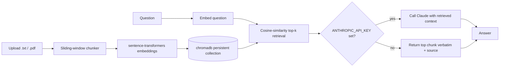

# RAG Document Q&A

A small, self-contained Retrieval-Augmented Generation (RAG) service for asking grounded
questions over your own documents. Upload a text or PDF file, and ask questions against it
through a FastAPI HTTP API: the service retrieves the most relevant passages with a local
embedding model and a persistent vector store, then answers either with Claude (when an
Anthropic API key is configured) or with a deterministic, fully offline extractive fallback —
so the service, and its test suite, never depend on network access or a paid API key to work.

## Why this exists

RAG is the standard pattern for grounding an LLM's answers in a private document set rather
than its training data, but most example implementations either hide the moving parts behind a
framework or hard-depend on a paid API to run at all — which makes them hard to read, and
impossible to test in CI. This project implements every stage of the pipeline (chunking,
embedding, vector storage, retrieval, and generation) directly and briefly enough to read in one
sitting, and treats "runs with zero credentials" as a first-class requirement rather than an
afterthought, including a retrieval-quality evaluation script with its own bundled labeled
dataset.

## Architecture

```
                 ingest                    embed                 store
   ┌──────────┐   ──────▶   ┌──────────┐   ─────▶   ┌──────────┐   ──────▶   ┌──────────────┐
   │  .txt /  │              │ sliding- │             │ sentence- │             │   chromadb   │
   │  .pdf    │              │  window  │             │transformers│            │ (persistent, │
   │ document │              │ chunker  │             │ (CPU, all- │            │   cosine     │
   └──────────┘              └──────────┘             │ MiniLM-L6) │            │  similarity) │
                                                        └──────────┘             └──────────────┘
                                                                                        │
                                                                                        │ query
                                                                                        ▼
   ┌──────────┐    answer    ┌────────────────────┐    top-k chunks    ┌──────────────────────┐
   │  client  │   ◀───────   │ generation          │   ◀─────────────  │  retrieval            │
   │ (curl /  │               │ - Anthropic API if  │                    │  (embed question,     │
   │  /docs)  │   question    │   ANTHROPIC_API_KEY │                    │   cosine-rank chunks) │
   └──────────┘   ───────▶    │ - else: extractive  │                    └──────────────────────┘
                               │   (top chunk, as-is)│
                               └────────────────────┘
```



## Setup & Run

```bash
python -m venv .venv
source .venv/bin/activate        # Windows: .venv\Scripts\activate

pip install -r requirements.txt
pip install -e .                 # makes the rag_doc_qa package importable

uvicorn rag_doc_qa.api:app --reload --port 8000
```

The API is now at `http://127.0.0.1:8000`, with interactive docs at `/docs`.

### Configuration

All configuration is via environment variables (see `src/rag_doc_qa/config.py`), all optional:

| Variable | Default | Purpose |
|---|---|---|
| `ANTHROPIC_API_KEY` | unset | When set, `/ask` calls the real Anthropic API for generation |
| `ANTHROPIC_MODEL` | `claude-sonnet-5` | Model used for grounded generation |
| `EMBEDDING_MODEL_NAME` | `all-MiniLM-L6-v2` | sentence-transformers model for embeddings |
| `CHROMA_PERSIST_DIR` | `./chroma_data` | Local directory for the persistent vector store |
| `CHROMA_COLLECTION_NAME` | `documents` | chromadb collection name |
| `CHUNK_SIZE_TOKENS` | `500` | Approx. tokens (whitespace-split words) per chunk |
| `CHUNK_OVERLAP_TOKENS` | `50` | Overlap between consecutive chunks |
| `DEFAULT_TOP_K` | `3` | Chunks retrieved per question when `top_k` isn't specified |

## Example usage

Upload the bundled sample document:

```bash
curl -s -X POST http://127.0.0.1:8000/documents \
  -F "file=@data/sample_document.txt"
```

```json
{
  "document_id": "sample-document-9f3c1a2b",
  "filename": "sample_document.txt",
  "num_chunks": 6
}
```

Ask a question grounded in it:

```bash
curl -s -X POST http://127.0.0.1:8000/ask \
  -H "Content-Type: application/json" \
  -d '{"question": "What encryption algorithm does Nimbus use to protect data at rest?", "top_k": 3}'
```

Offline (no `ANTHROPIC_API_KEY` set) response — the extractive fallback:

```json
{
  "question": "What encryption algorithm does Nimbus use to protect data at rest?",
  "answer": "All data stored in Nimbus is encrypted at rest using AES-256 encryption, with a unique data key generated for every object and wrapped by a master key stored in a separate hardware security module. ...",
  "mode": "extractive",
  "sources": [
    {"source": "sample_document.txt", "chunk_index": 2, "score": 0.81},
    {"source": "sample_document.txt", "chunk_index": 0, "score": 0.42},
    {"source": "sample_document.txt", "chunk_index": 4, "score": 0.38}
  ]
}
```

With `ANTHROPIC_API_KEY` set, the same request instead returns `"mode": "anthropic"` with a
synthesized, cited answer generated by Claude from the same retrieved chunks.

## How the offline fallback works

`generate_answer()` in `src/rag_doc_qa/generation.py` checks whether `ANTHROPIC_API_KEY` is set:

- **Set** — calls the Anthropic API (`anthropic` Python SDK) with the retrieved chunks as
  context and a system prompt that restricts the model to grounding its answer in them. If the
  API call itself fails, the response degrades to the extractive fallback (`mode:
  "extractive_fallback_api_error"`) rather than failing the request.
- **Not set** — returns the single most relevant retrieved chunk verbatim, plus its source
  file and relevance score (`mode: "extractive"`). This is fully deterministic, makes no network
  call, and is what the entire test suite and CI pipeline exercise — the service and its tests
  work identically with zero secrets configured.

## Testing

```bash
pip install -e ".[dev]"
ruff check .
pytest -q
```

The suite covers the sliding-window chunker (window/overlap arithmetic, edge cases), document
ingestion (plain text and a mocked PDF extraction branch), retrieval ranking against the bundled
sample document, the extractive and Anthropic generation branches (the Anthropic client is
always mocked — the suite never makes a real network call), and an end-to-end
upload-then-ask flow through the FastAPI test client. CI (`.github/workflows/ci.yml`) runs the
exact same commands with no `ANTHROPIC_API_KEY` configured anywhere in the workflow.

### Retrieval evaluation

A small bundled labeled dataset (`data/eval_dataset.json`, grounded in `data/sample_document.txt`)
is used to report retrieval precision@k / recall@k:

```bash
python scripts/evaluate_retrieval.py --top-k 3
```

Each question's ground truth is derived dynamically as "the chunks that contain the expected
answer substring," computed after chunking — so the eval stays valid even if chunk-size/overlap
settings change the exact chunk boundaries.

## Project structure

```
rag-doc-qa/
├── src/rag_doc_qa/
│   ├── api.py            FastAPI app (/documents, /ask, /health)
│   ├── chunking.py        Sliding-window text chunker
│   ├── config.py           Environment-driven settings
│   ├── embeddings.py       sentence-transformers loading/encoding
│   ├── generation.py       Anthropic call + extractive fallback
│   ├── ingest.py            Text/PDF extraction, chunking, embedding, storage
│   ├── retrieval.py         Query embedding + cosine-ranked retrieval
│   ├── schemas.py           Pydantic request/response models
│   └── vectorstore.py        chromadb persistent collection wrapper
├── scripts/
│   └── evaluate_retrieval.py  Precision@k / recall@k against the bundled eval set
├── data/
│   ├── sample_document.txt    Bundled sample document (fictional product docs)
│   └── eval_dataset.json      Hand-written Q/A pairs grounded in the sample document
├── tests/                    pytest suite (chunking, ingest, retrieval, generation, API)
├── Dockerfile
├── requirements.txt
├── pyproject.toml
└── .github/workflows/ci.yml
```

## Scope cuts

This is a focused portfolio piece, not a production RAG platform. Deliberately out of scope:
multi-tenant document management and deletion endpoints, authentication, a UI beyond FastAPI's
auto-generated `/docs`, hybrid/BM25 retrieval, re-ranking, streaming responses, and persistence
of conversation history. The sliding-window chunker also approximates "tokens" as whitespace-split
words rather than using a model-specific tokenizer, trading a small amount of precision for zero
extra dependencies and fully deterministic, offline-friendly chunking.

## License

MIT — see [LICENSE](LICENSE).
